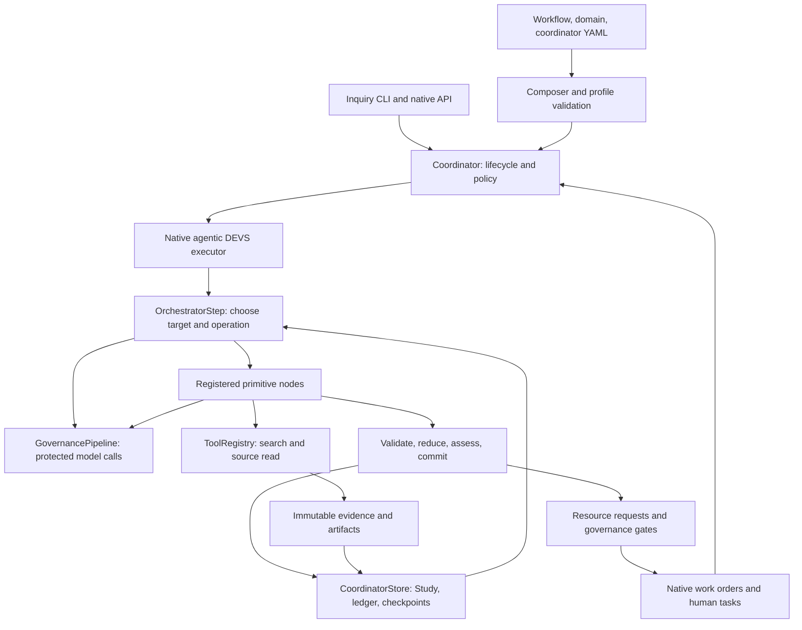

# Cognitive Core Inquiry: Native Architecture and Extension Design

**Status:** Design draft for review; implementation has not begun.

**Date:** 2026-11-08.

**Repository baseline:** `490251e438bf79d382cfd3ecd71fd22e19673115`, branch `feat/reasoning-inquiry`.

**Scope:** Ordinary reasoning, framing, public-source research, criticism, synthesis, and user clarification.

**Architectural requirement:** Inquiry uses the full native Cognitive Core execution and governance machinery.

This document describes the existing implementation at the baseline above and proposes extensions to it. Statements marked **Existing** describe inspected code. **Proposed** describes work that still needs implementation and verification. YAML examples containing proposed fields are design specifications, not configurations that run on the current checkout.

Repository references use relative links and named functions so the design can be reviewed alongside the code. The separate inquiry prototype is a source of reusable components and diagnostic evidence; it is not the target runtime.

### Reading guide

- [Architectural decision](#1-decision-and-intended-result) and [existing machinery/gaps](#2-existing-architecture-and-the-extension-boundary).
- [Native execution](#3-target-native-architecture) and [authoritative Study](#4-authoritative-study-and-artifact-model).
- [YAML and primitive profiles](#5-configuration-and-registered-primitive-profiles).
- [Research tools](#6-research-tools-and-evidence-handling), [orchestration/review](#7-orchestration-review-and-completion), and [budgets](#8-budgets-protected-calls-and-stopping).
- [Governance](#9-governance-and-epistemic-extension) and [durability/human resources](#10-durable-native-execution-and-human-resources).
- [Worked case](#11-worked-design-case-fixed-versus-adaptive-policy-retrieval), [acceptance/evaluation](#12-verification-and-evaluation-design), and [migration](#13-implementation-sequence-and-migration).
- [Review decisions](#14-review-decisions-and-implementation-risks) and [repository references](#repository-reference-index).

## 1. Decision and intended result

**An inquiry is a native, Coordinator-owned, agentic Cognitive Core workflow.** The Coordinator owns its lifecycle. The native DEVS orchestrator chooses cognitive operations. Registered primitive nodes execute those operations. The shared governance pipeline, epistemic assessment, resource contracts, human tasks, persistence, and audit ledger apply throughout.

The implementation extends that framework to maintain an evolving study: a question, provisional decomposition, claims, evidence, objections, findings, and a progressively refined answer. It must support suspension and continuation across processes and days.

The public inquiry CLI becomes a client of the Coordinator. It will not call the prototype's independent scheduler, protected-call adapter, or JSON checkpoint store to execute a study. There will be one execution authority and one authoritative study state.

### 1.1 What the first version must do

1. Accept a question and its purpose, frame it without silently changing the user's goal, and ask consequential clarifications when needed.
2. Form revisable subquestions and competing explanations; identify evidence or reasoning that could distinguish them.
3. Search, select and read sources; distinguish discovery leads from material actually read.
4. Develop conditional arguments and evidence-supported claims, with explicit premises and limitations.
5. Identify material objections and resolve them through evidence, reasoning, qualification, withdrawal, reframing, or user input.
6. Integrate the branches into a useful answer, including unresolved questions and what could change the conclusion.
7. Preserve the complete study, evidence identities, execution history, and outstanding work across suspension and restart.
8. Apply Cognitive Core's native controls, final governance, and auditable human handoffs.

Simulation, optimization, statistical estimation, and execution against private enterprise systems are outside the first implementation. The study can formulate a needed analysis and record it as unperformed. Later execution of such analysis must use registered capabilities and typed work orders, not an alternate agent framework.

### 1.2 Architectural invariants

| ID | Required invariant |
|---|---|
| A1 | Every new inquiry starts through `Coordinator.start` and the native workflow/domain composition path. |
| A2 | The native `OrchestratorStep` is the sole sequencing authority; deterministic framework rules validate its decisions. |
| A3 | Every model attempt, including orchestration, retrieval planning, assessment, and repair, uses the shared protected-call path and carries instance/domain identity. |
| A4 | Every accepted primitive operation passes through the native completion boundary, epistemic assessment, durable state commit, and audit. |
| A5 | The authoritative Study is part of native workflow state and references immutable evidence/artifacts. There is no second mutable inquiry checkpoint authority. |
| A6 | Clarifications and delegated analyses use native resource requests, contracts, work orders, tasks, suspension, and resume. |
| A7 | Govern remains terminal. Research adequacy, execution completion, and governance clearance remain separate properties. |
| A8 | Workflow/domain YAML controls research policy through supported, validated configuration. Unknown or contradictory profile settings fail explicitly. |
| A9 | A live inquiry never silently changes into fixture simulation or reports a failed operation as an answered question. |
| A10 | The prior-authorization and loan-modification packs retain their declared behavior through explicit compatibility defaults and regression coverage. |

“Full machinery” means these native lifecycle and control paths are actually exercised and verified. It does not mean every study must invoke every primitive or create an external action. Read-only research has no business execution operation to perform, but it still uses the framework's controls, resource handling, and release governance.

## 2. Existing architecture and the extension boundary

### 2.1 Native execution that already exists

The current native entry is `Coordinator.start(workflow_type, domain, case_input, ...)`. It creates an `InstanceState`, carries correlation/lineage, applies start controls, resolves workflow/domain files, and executes them. `_execute_workflow` selects `run_agentic_workflow_devs` for `mode: agentic`. The agentic executor invokes native Retrieve, Govern, and generic primitive node factories. Its completion callback returns to the Coordinator for epistemic assessment, ledger recording, and resource-request handling. [C01], [C02], [C03], [C04]

| Existing subsystem | Actual responsibility | Inquiry use or extension |
|---|---|---|
| Coordinator runtime and policy | Instance lifecycle, governance tiers, quality gates, resource/delegation routing, work orders, human queues | Own the study lifecycle and all handoffs. |
| Three-layer composer | Workflow structure + domain configuration + case input; resolves `${domain.*}` | Load the inquiry pack and validate its registered execution/operation profiles. |
| Agentic DEVS executor | Orchestrator and primitive components, asynchronous execution, completion callbacks | Add typed study targets, explicit transition policy, protected orchestration, and native resume. |
| Primitive registry, schemas, templates | Cognitive operations and their contracts | Add registered inquiry profiles with exact output schemas and study reducers. |
| ToolRegistry and Retrieve node | Execute registered data sources and preserve actual tool results | Support per-call arguments, search/read distinction, immutable passages, and operation recovery. |
| GovernancePipeline | Start gates, protected calls, rate/cost/cache/PII integration, specification capture, checkpoint hooks | Apply to all inquiry model work; wire currently disconnected lifecycle hooks. |
| Epistemic engine | Mechanical proxies, model judgments, cross-step coherence, gate triggers | Add profile-aware research observations without treating structure or confidence as truth. |
| CoordinatorStore and ledger | Instances, work orders, suspensions, transactions, idempotency, hash-chained events | Add authoritative running checkpoints, immutable artifacts, invocation state, and atomic acceptance. |
| TaskQueue and contracts | Human tasks, typed resource interface scaffolding, provider fan-in | Complete clarification fulfillment and validate returned research artifacts. |
| Replay/specification/evaluation modules | Replay records, configuration manifests, evaluation baselines | Bind recovery and evaluation to the actual study configuration, runtime, and evidence. |
| Native API, CLI, and trace | Public entry points, instance/task operations, trace and ledger inspection | Expose study views and typed fulfillment through these services. |

Sources: [C01]–[C14], [C18], [C19].

### 2.2 What the prototype currently does

**Existing:** `cognitive_core/inquiry/cli.py` builds `InquiryRunner`, `CoreReasoner`, and `SerperResearchProvider`. `InquiryRunner` schedules its own phases. `CoreReasoner` uses hardcoded operation profiles for most steps; Frame alone uses its shared primitive template. The runner owns its own budgets, state transitions, and JSON checkpoint. It reuses the LLM factory and protected calls, but not the native coordinator lifecycle. [C15], [C16]

Reusable assets include the public-source adapter, source-read safeguards, passage/claim concepts, Frame schema, citation validation, report conventions, and regression cases. The scheduler, prompt ownership, and persistence authority must be replaced by native integration. This is a migration, not a wrapper around `InquiryRunner`.

### 2.3 Verified gaps relevant to inquiry

| ID | Baseline observation | Required design consequence |
|---|---|---|
| G1 | `OrchestratorStep._make_decision` calls `llm.invoke` directly; primitive nodes use the protected-call path. | Protect and account for orchestrator calls as well. [C03], [C04] |
| G2 | Both the orchestrator prompt and Python impose closing transitions, including a passing Challenge leading to Govern; some fallback profile names are appeal-specific. | Select one registered transition policy and render/enforce the same rules. Distinguish branch review from final review. [C03], [C05] |
| G3 | Native node factories choose schemas by primitive name, not named YAML profile. Generic parsing can salvage malformed output. | Bind inquiry profiles to exact schemas; rejected/salvaged outputs cannot update accepted Study state. [C04], [C06] |
| G4 | Native retrieval planning chooses tool names and then passes common context; inquiry requires query/URL arguments per call. | Extend native Retrieve and ToolRegistry contracts. [C04], [C07] |
| G5 | `WorkflowState` lacks a study model; normal context includes short previews of findings and retrieved data. | Add a typed Study and target-aware context projection with actual evidence. [C08] |
| G6 | The latest global Reflect can modify later operations and is described as authoritative; it has no branch/revision scope. | Scope and consume advice by target and revision, subordinate to user purpose and configured policy. [C03] |
| G7 | Coordinator resume always calls sequential `step_resume`; `AgenticWorkflowExecutor` has no corresponding native resume entry point. | Implement agentic continuation and dispatch resume by workflow mode. [C01], [C03], [C17] |
| G8 | Active `Coordinator.checkpoint` can return an empty object. Suspension compaction truncates source data and generated artifacts. | Persist accepted running state and immutable artifacts; compaction must affect views only. [C01], [C09] |
| G9 | Human resource tasks specify `fulfill_resource`, but `resolve_task` handles approve/reject/defer and no fulfillment implementation exists. | Complete typed resource fulfillment without treating an answer as governance approval. [C01], [C10] |
| G10 | Contract validation is mainly required-field/enum checking; child result summaries truncate findings and discard research structure. | Validate research results against registered schemas and return durable artifact references. [C01], [C11] |
| G11 | Replay/circuit-breaker recording exists in `record_step_result`, but no production caller was found. Specification capture omits coordinator/prompt content in the current path. | Wire and verify lifecycle hooks; persist the effective specification and running checkpoint. [C12], [C13], [C14] |
| G12 | Orchestrator parse failure can return `action: end`; non-interrupt executor termination can report completed; missing LLM setup can trigger simulation. | Define explicit termination outcomes and reject implicit success/fallback in live inquiry. [C01], [C03] |
| G13 | API startup cleanup terminates prior running instances and attempts task cancellation; start is not a durable immediate-submission queue. | Add recovery-aware startup and durable submission semantics for multi-day work. [C18] |
| G14 | Agentic metadata does not consistently carry instance/domain identity, and repeat/step limits do not count all model attempts. | Carry identity end to end and use explicit global/target usage accounting. [C03], [C04] |

This is an inquiry-focused audit, not a claim that every optional module in the repository has been validated. Optional imports for unavailable modules are not foundations assumed by this design.

## 3. Target native architecture



### 3.1 One study, explicit targets

The first implementation runs one Coordinator-owned study with sequentially selected research operations. Subquestions are explicit study targets, not independent Python loops. Parallel branch execution can later be enabled through native delegated workflows; no bespoke agent spawning is introduced.

Each invocation carries a runtime-assigned ID, selected primitive/profile, target, and expected Study revision. A target identifies the study, a question, a claim set, or a synthesis/report revision. Human-readable step names are labels, not identities or budget keys.

The expected Study revision is a concurrency precondition. Review validity uses a separate substantive dependency basis, defined in Section 4.2; recording a review does not invalidate that same review.

Thread a native execution context through orchestration, node factories, tools, and governance: instance/correlation IDs, invocation/attempt IDs, domain, profile/schema/specification identity, target, and resolved model settings. Extend the existing call interfaces compatibly rather than infer this information from a step name or process-global trace. Usage records and cache/trace scope must remain attributable when two studies execute in the same process.

### 3.2 Native operation lifecycle

1. The orchestrator receives the original task, current Study view, unresolved issues, available profiles, and remaining resources.
2. It proposes a typed operation and target. The runtime validates the profile/primitive binding, dependencies, revision, transition, and budget.
3. The Coordinator-owned execution record reserves the permitted work and persists an invocation intent before dispatch.
4. A native primitive node renders the selected profile's instructions and exact schema, then uses protected model calls and registered tools as required.
5. Tool results are recorded with their real status and immutable content references. A later interpretation failure does not erase a successful read.
6. The node returns a candidate result. Schema, identity, provenance, and version validation determine whether it can update the Study.
7. A deterministic reducer applies accepted changes. The native completion path computes epistemic observations, records usage and provenance, and commits the new state, ledger event, and checkpoint.
8. The native resource callback handles blocking needs; otherwise the orchestrator receives the updated Study.
9. A final reviewed artifact passes through Govern and the Coordinator's quality/governance policy before release.

The current engine mutates workflow state before its callback. Implementation must introduce a validated candidate/commit boundary, rather than append an invalid result and later treat its mere presence as a completed requirement. Invalid attempts remain visible in diagnostics and usage accounting.

## 4. Authoritative study and artifact model

**Proposed:** Add an optional `study` field to native `WorkflowState`, validated through the registered inquiry execution profile. Its serialized representation is the authoritative accepted study snapshot. Source bodies and large artifacts live in immutable Coordinator-owned storage and are referenced by identity and content hash.

The Study is a research domain artifact. It is not the existing `ExecutionArtifact`, which records downstream action execution. [C08], [C20]

| Record | Required content |
|---|---|
| Study identity | Study/instance/correlation IDs, schema version, monotonically increasing revision, effective specification identity. |
| Task | Original question and purpose; explicit user amendments and their provenance. |
| Frame | Working question, scope, assumptions, alternatives, answer criteria, subquestion DAG, version and change rationale. |
| Question | Stable ID, contribution, dependencies, evidence needs, active/answered/conditional/unresolved disposition. |
| Claim | Stable ID and revision; text, basis (source/inference/assumption/user), premises, evidence references, qualifications, superseded status. |
| Evidence artifact | Original/final URL or user provenance, retrieval time, content/extraction hash, format, truncation/failure metadata, immutable passages. |
| Evidence assessment | Target claim/question, source task/comparator/outcome/conditions, support or contradiction, transfer limits, assessed-by invocation. |
| Objection | Target claim/revision, material concern, possible resolution, open/resolved/accepted-limitation/rejected disposition and rationale. |
| Finding | Question target, claims, reasoning summary, remaining issues, supporting invocation and frame revision. |
| Clarification | Stable request ID, precise user question, reason, blocking flag, target/revision, native work-order/task IDs, validated answer. |
| Synthesis/report | Current integrated answer and artifact revisions, criteria coverage, claim/evidence lineage, final-review binding. |
| Usage | Model/tool attempts and reservations, actual consumption, remaining global allocation, target repeat counts. |
| Outcome | Research outcome and reason, separate from native execution and governance status. |

### 4.1 Reduction and invalidation

Models propose typed domain changes. They do not return arbitrary JSON patches over workflow state. Profile-specific reducers verify referenced IDs, input revision, permitted changes, citation membership, and dependency consistency.

Reframing preserves a question ID only if its meaning is unchanged. Changed questions receive new identities or explicit versions. Dependent findings are marked stale and revisited; their history remains available. A changed premise, claim, source assessment, or synthesis invalidates reviews that depended on its earlier revision.

Evidence text is immutable. A later fetch of the same URL creates a new evidence revision. A citation resolves to the specific passage that was used, even if the web page subsequently changes.

Acceptance by a reducer means the record is structurally and historically coherent. It does not mean the claim is scientifically true or that a model's relevance assessment is correct.

Mutation ownership is explicit:

| Operation | Permitted Study proposals or runtime effects |
|---|---|
| Frame | Frame/question graph changes, assumptions, and clarifications; reducer invalidates affected descendants. |
| Retrieve | Actual tool/source outcomes and evidence availability; cannot declare a question answered merely because a source was read. |
| Investigate | Claims, finding revisions, assumptions, issue/objection responses, and the target question's proposed disposition with rationale. |
| Verify / Challenge | Target-specific assessments and objections; cannot silently rewrite the challenged claim. |
| Reflect | Scoped advice and clarification needs; no implicit branch closure or unrelated mutation. |
| Deliberate | Integrated answer, criteria coverage, proposed study outcome, and explicit reopening requests for affected dependencies. |
| Generate | Candidate report bound to the selected synthesis and evidence basis. |
| Govern | Governance disposition for that release package; cannot upgrade its research adequacy. |

Reducers validate the permitted change set, target, profile, and dependency effects. An answered/conditional disposition is an inspectable substantive assessment; structural acceptance does not certify truth. Output profiles must be compatible with the selected execution profile and permitted target, as well as the primitive.

### 4.2 State revision and review basis

The monotonically increasing Study/state revision supports durable commits and optimistic concurrency. Separately, a runtime-computed **ReviewBasis** contains the exact report artifact ID/revision/hash and the versions of its substantive dependencies: task/frame, assumptions, claims, evidence assessments/passages, synthesis, and relevant issue dispositions.

Recording usage, a routing decision, a passing review, or governance/task disposition can change state revision without changing ReviewBasis. A material change to one of the bound dependencies invalidates the review. A failed Challenge that opens a substantive issue changes the basis of the next candidate report.

The runtime derives the dependency fingerprint from the accepted artifact manifest; the model cannot invent or certify it. Human approval binds to that same basis. Fulfilling the approval task therefore does not invalidate the approval merely by committing a new state revision.

### 4.3 Context projection

The orchestrator view contains the original task, current frame, candidate answer, criteria coverage, unresolved issues, dependencies, pending requests, budgets, and recent consequential changes. It must include the actual question, not only a generic domain goal and compact step summaries.

The primitive view contains its target, relevant premises/findings, applicable objections, scoped Reflect guidance, and the actual passages required for its operation. Omitted or truncated material is disclosed. Stored evidence is never replaced by a short context preview.

Source documents, search snippets, and prior model outputs are untrusted data. The configured task and explicit user amendments define authority. A retrieved document or Reflect output cannot rewrite that boundary.

## 5. Configuration and registered primitive profiles

### 5.1 Configuration ownership

Use the existing workflow/domain/case composition mechanism. The proposed pack is `demos/inquiry/`, containing a coordinator configuration, an agentic workflow, a generic inquiry domain, and example case inputs. Inquiry-specific Python provides registered data models, reducers, context projection, and tool adapters; it does not choose the next research step.

| Location | Content |
|---|---|
| `demos/inquiry/workflows/inquiry.yaml` | Available primitives, native execution profile, constraints, strategy/profile references. |
| `demos/inquiry/domains/reasoning_research.yaml` | Research method, evidence standards, named primitive configurations, domain governance floor. |
| `demos/inquiry/coordinator_config.yaml` | Native directories, governance/quality policy, capabilities, resource contracts, provider registration. |
| Case input | User question, purpose, supplied context, selected study limits, authorized source scope. |
| Shared registry and engine | Implemented profile/schema/context/reduction/transition bindings and invariant enforcement. |

Existing supported keys include `mode`, `goal`, `available_primitives`, `orchestrator.strategy`, `primitive_configs`, primitive parameters/model/temperature/SLA, and the existing constraints. [C02], [C03], [C06]

The following extensions are proposed and must be implemented before the examples work:

| New concept/key | Consumer and meaning |
|---|---|
| `execution_profile: inquiry.v1` | Composer/native executor selects the registered Study, transition, context, and strict-acceptance behavior. Omission selects legacy behavior. |
| `primitive_configs.<name>.output_profile` | Registry/node factory selects an allowlisted schema, output-contract rendering, context projection, and reducer compatible with that primitive. |
| `constraints.max_repeat_per_target` | Native orchestrator bounds repeated work on a stable target and unchanged material issue. |
| `constraints.budgets` | Shared execution budget ledger, with units defined in Section 8. |
| `tool_providers` in coordinator configuration | Coordinator resolves named registered adapters and permitted tools; it does not import arbitrary code named by model output. |
| `contracts.<name>.schema_profile` | Contract registry applies the complete request/result schema for inquiry resources. |
| Candidate-evaluation admission policy | Native evaluation gate admits authorized, versioned evaluation cases under a declared candidate specification without granting normal study release eligibility. |

Unknown profiles/keys, mismatched schemas, or incompatible transition settings must fail during validation. The prompt and runtime must derive legal actions from the same registered policy.

### 5.2 Proposed workflow example

The numbers below are initial ceilings for evaluation, not established optimal budgets.

```yaml
name: inquiry
mode: agentic
execution_profile: inquiry.v1          # proposed framework extension
goal: "${domain.goal}"

available_primitives:
  - frame
  - retrieve
  - investigate
  - verify
  - deliberate
  - challenge
  - reflect
  - generate
  - govern

constraints:
  max_steps: 80                       # accepted native primitive operations
  must_include: [frame, deliberate, generate, challenge, govern]
  must_end_with: govern
  challenge_must_pass: true           # current final artifact review
  max_repeat_per_target: 3            # proposed; not a global primitive quota
  budgets:                           # proposed shared accounting
    model_calls: 100
    searches: 12
    source_reads: 18
    reframes: 3
    output_repairs_per_operation: 2
    closeout_reserve_model_calls: auto # proposed: compile from closure policy
    closeout_reserve_steps: auto       # concrete reservation saved in manifest

orchestrator:
  model: default
  strategy: "${domain.orchestrator_strategy}"

primitive_configs: "${domain.primitive_configs}"
```

Pure conceptual work may legitimately need no Retrieve. Empirical claims must identify their evidence or remain qualified. The workflow does not mandate a fixed source count or criticism round after every finding.

### 5.3 Proposed domain strategy

```yaml
domain_name: reasoning_research
version: "1.0"

goal: |
  Develop a useful, defensible answer to the supplied inquiry,
  preserving its purpose, evidence limits, and unresolved questions.

orchestrator_strategy: |
  Maintain the original task, current frame, candidate answer,
  important claims, evidence, and unresolved issues.

  Select the unresolved issue whose resolution could most change
  the answer. Choose a registered operation that can address it.
  State the expected contribution and assess the actual change.

  Search to distinguish plausible answers. Read promising leads.
  Assess what a source establishes for the specific claim before
  relying on it. Preserve contrary evidence and transfer limits.

  Reframe when the question or decomposition needs a material change.
  Request user input for consequential intent or unavailable context.
  Revise when the current material supports a specific correction.

  When an action adds no material evidence or reasoning, change
  the approach, narrow the conclusion, defer the issue, or close.
  Preserve resources for integration, final review, and Govern.

governance:
  tier: auto
```

The example `auto` floor is a proposed pilot setting for public-source, read-only architectural inquiry. Normal upward escalation, quality gates, and configured review still apply. It must not be implemented through exemptions, locked-tier shortcuts, or fabricated passing evaluation baselines. Other inquiry domains declare their appropriate governance policy.

### 5.4 Operation profiles and output contracts

Each named configuration selects an existing primitive and a registered inquiry output profile. Existing generic envelope fields needed for native epistemic/governance processing are retained. The selected schema is rendered as the single authoritative output contract; conflicting generic JSON examples are removed from that profile's rendered prompt.

| Named operation | Primitive | Proposed profile | Substantive result |
|---|---|---|---|
| `frame_study` | Frame | `inquiry.frame.v1` | Faithful working question, alternatives, criteria, provisional DAG, assumptions, clarification requests. |
| `retrieve_evidence` | Retrieve | `inquiry.retrieve.v1` | Validated per-call plan, actual tool outcomes, discovered/read evidence references, remaining evidence need. |
| `investigate_question` | Investigate | `inquiry.finding.v1` | Claims, premises, source assessments, conditions, alternatives, unresolved issues, material change. |
| `verify_support` | Verify | `inquiry.support_review.v1` | Claim-specific support/comparator/qualification review, separated from deterministic reference checks. |
| `challenge_claim` / `challenge_report` | Challenge | `inquiry.challenge.v1` | Targeted objections, consequences, possible resolutions, and review target/revision. |
| `reflect_progress` | Reflect | `inquiry.reflection.v1` | What changed, remaining material issue, and a scoped recommendation for the next operation. |
| `integrate_study` | Deliberate | `inquiry.synthesis.v1` | Integrated answer, criteria coverage, contradictions, limitations, and proposed research outcome. |
| `render_report` | Generate | `inquiry.report.v1` | Faithful candidate artifact referencing the reviewed claim/evidence set. |
| `govern_release` | Govern | `inquiry.govern.v1` | Native disposition/tier/work order linked to the exact release package and explicit research outcome. |

For example:

```yaml
primitive_configs:
  frame_study:
    primitive: frame
    output_profile: inquiry.frame.v1   # proposed registry binding
    params:
      question: "${input.question}"
      purpose: "${input.purpose}"
      additional_instructions: |
        Preserve the application being studied and distinguish it
        from restrictions on available research sources. Keep
        comparative questions neutral and identify discriminating evidence.

  investigate_question:
    primitive: investigate
    output_profile: inquiry.finding.v1
    params:
      question: "Answer the active question supplied in the target context."
      scope: "Use the selected premises, passages, and unresolved objections."
      additional_instructions: |
        Assess source task, comparator, outcome, and transfer limits.
        Separate reported observations, inference, assumptions, and
        user-supplied facts. On revision, identify the claim changed
        and the evidence or argument that warrants the change.
```

These excerpts do not form a complete pack. Implementation must provide every referenced operation and validate required parameters through the shared registry.

Reflect is advisory. Its recommendation includes target IDs, applicable frame/artifact revision, and a consumption condition. It may be accepted, rejected with a reason, superseded, or invalidated. It cannot declare unrelated facts proven or silently alter another branch. The orchestrator remains the decision owner; there are not two conflicting next-action authorities.

## 6. Research tools and evidence handling

### 6.1 Native tool integration

Reuse `SerperResearchProvider` and its public-source protections through Coordinator provider registration. Extend native Retrieve's planning contract to specify individual calls: tool, validated arguments, target issue, and purpose. Search and reading remain registered ToolRegistry operations. [C04], [C07], [C16]

The planner uses a registered `RetrievalPlan` schema internally. Its result is not itself an executed Retrieve outcome. Native Retrieve validates and executes the calls, then produces a profile-valid final result containing actual tool outcomes. Every internal model call is protected and accounted for.

Extend registered tool specifications with an optional argument schema and an explicit execution adapter. Existing case-source tools retain their current context interface. Inquiry tools receive validated arguments separately from runtime-owned identity, authorization, and budget context; a planner cannot overwrite that context by supplying extra fields.

Search calls contain a query and bounded result count. Read calls contain an authorized/discovered source identifier or validated URL. A plan that names an unknown tool or URL fails validation; native inquiry does not fall back to calling every available tool.

Persist the stages of each call: proposed, reserved, dispatched, result recorded, applied. A completed cached read is reused with explicit feedback. A duplicate adds no new evidence unless the request explicitly seeks a fresh version and policy allows it.

### 6.2 Evidence is not a source-count score

Maintain three separate facts:

1. A source was discovered.
2. Its content was read and stored.
3. An assessment links particular passages to a particular claim, including limitations.

Only stored passages support source citations. A source's credibility or relevance is claim-specific. A vendor case report may establish that a vendor reports an outcome, while failing to establish a controlled comparative advantage.

Prefer references to canonical passage IDs and optional validated excerpt offsets. Render exact excerpt text from stored content where needed. Exact membership checks remain; semantic support is assessed separately and is never inferred merely from a valid reference.

Record failed reads, truncation, extraction version, and freshness explicitly. Source refresh creates new content identities and can invalidate dependent findings/reviews. The original passage remains available for audit.

## 7. Orchestration, review, and completion

### 7.1 Study decisions

The registered inquiry decision schema selects a known `params_key`, matching primitive, target, and expected Study revision. It also records the material issue and intended contribution. Invocation IDs and usage are assigned by the runtime.

The orchestrator chooses work according to unresolved issues and dependencies. Equal branch turns and fixed revision counts are not research objectives. Global limits bound resource use and repeated work. The strategy and criteria-coverage view guide allocation; release checks require every consequential branch to have an explicit resolved, conditional, deferred, or limited disposition.

Observable progress includes a new relevant passage, resolved contradiction, rejected unsuitable source, changed premise, narrower claim, answered clarification, or explicit limitation. Rephrasing a finding, rereading cached text, or obtaining model agreement does not establish progress. These judgments are recorded and evaluated; an arbitrary model confidence threshold does not replace them.

### 7.2 Transition policy

The execution profile supplies one transition policy consumed by both the native executor and the orchestrator prompt.

| Situation | Permitted behavior |
|---|---|
| Initial study | Frame; request necessary user context through native resource handling. |
| Exploration | Retrieve, Investigate, Verify, targeted Challenge, Reflect, or a justified reframe. |
| Provisional integration | Deliberate can expose new needs and return to exploration. |
| Branch Challenge passes | Return to orchestration for remaining issues. A branch pass cannot close the study. |
| Candidate final artifact generated | Require final Challenge bound to that artifact and supporting Study revision. |
| Final Challenge identifies material defect | Reflect/research/revise as permitted, then create and review a new final artifact. |
| Final review passes and structural release checks hold | Invoke Govern on that exact release package. |
| Govern completes | Terminal native operation; Coordinator still applies its governance/review lifecycle. |

A review is invalidated when its relevant evidence, claims, synthesis, or report changes. Generate cannot strengthen conclusions or add unexamined factual claims while editing presentation.

Final Challenge may pass for a conditional or evidence-limited report when the report faithfully states those limitations and supports the claims it does make. It does not require every underlying empirical question to be resolved.

`must_include` and final-review constraints count accepted operations against the appropriate target. They cannot be satisfied by malformed outputs or an unrelated branch's review.

### 7.3 Three distinct outcomes

| Dimension | Examples | Meaning |
|---|---|---|
| Native instance lifecycle | running, suspended, completed, failed, terminated | Whether execution can proceed or has ended. |
| Research outcome | open, answered, conditional, evidence_limited, budget_exhausted | What the study established and why work stopped. |
| Governance disposition | release, sampled review, required review, hold/rejection | What the configured policy permits for the deliverable. |

A completed native instance can contain a reviewed, explicitly evidence-limited report. A governance approval does not turn that report into an empirically established answer. A crashed operation produces an execution failure and a provisional view of accepted work, not a successful research outcome.

Normal release requires a reviewed current artifact. When research resources are depleted, the reserved closeout can produce an honest partial report and take it through final Challenge and Govern. If hard limits or infrastructure failures prevent that sequence, the instance suspends or fails with the last accepted state; its provisional export is not a governed final release.

## 8. Budgets, protected calls, and stopping

The existing native `max_steps` counts primitive work, not every model/API attempt. Inquiry adds explicit shared accounting. [C03], [C12]

| Unit | Counted work |
|---|---|
| Accepted primitive steps | Validated native operations committed to Study. |
| Model attempts | Orchestrator, planner, primitive, semantic review, and output-repair calls; failed attempts are included. |
| Transport attempts | Provider retries recorded separately and charged according to actual execution. |
| Search/read attempts | Uncached dispatched tool requests, including failures and uncertain completion. |
| Target repetition | Admitted invocations keyed by runtime-known owning question/study identity and primitive/output profile, independent of step labels or paraphrased issue text. |
| Tokens/cost/time | Actual provider-reported usage where available; distinguish unknown usage from zero. |
| Closeout reserve | Native-step and model-attempt capacity withheld from research for integration, final artifact review, and Govern; other configured hard ceilings must reserve corresponding capacity. |

The hard repetition key uses the stable owning question (or study for global work), primitive, and registered output profile. Runtime lineage rules carry counters across a renamed or equivalent question; a new genuinely different question is recorded as such. Wording changes, invented step names, and self-reported progress cannot reset a hard counter. Repairs within one invocation have their own bounded attempt counter. Raising an allocation is an explicit recorded budget amendment.

For these two reservation fields, `auto` means the registered closure policy compiles a concrete native-step/model-attempt reservation, including orchestration and its bounded correction allowance. The resolved reservation is visible in the effective manifest; it is not estimated by the model. The policy validator rejects overall limits that cannot accommodate it. Research admission cannot spend that reservation. Configured token/cost/deadline ceilings must use a compatible reservation or explicitly prevent guaranteed closeout admission. A reserve guarantees capacity admission, not model success; failed closeout still yields the truthful suspended/failed outcome described above.

Budget reservation occurs before dispatch. Actual usage is reconciled afterward. Cache hits are recorded without pretending that another external request occurred. A crash after an external call but before result persistence may require a retry; the system records uncertainty and does not promise exactly-once network execution.

The protected-call pipeline is used for all model attempts with the resolved model, domain, and instance/correlation identity. Model/cache identity includes the effective specification, schema, evidence/Study revision, and relevant settings; semantic caching must not reuse a decision across incompatible study states or models. Budget admission remains a hard runtime check even if a provider limiter or telemetry integration fails.

Output repair is bounded, schema-aware, and part of the same native invocation. Rejected candidate output remains diagnostic, with protected data handled by existing controls. Repairs do not create findings or reset the research budget. Malformed orchestration cannot mean `action: end` success.

The selected live mode fails explicitly when its required model/provider is unavailable. Demonstration/fixture execution remains an explicit mode with clearly labeled results.

## 9. Governance and epistemic extension

### 9.1 Keep native controls in force

Inquiry uses the existing start gates, configured model evaluation gate, protected calls, epistemic assessment, quality policy, escalation, task queues, and Govern lifecycle. Model orchestration and tool/child dispatch must honor their relevant stop/permission controls. The implementation must wire the existing lifecycle hooks where the audit found no call site and verify their real execution. [C01], [C12]

Read-only public-source research enables only its declared tools and resource providers. There is no implicit downstream execution action. Later simulation or optimization providers use the same capability/work-order mechanism and return actual execution artifacts alongside research results.

### 9.2 Extend epistemic observations without overstating them

The existing mechanical layer uses structural proxies: successful source retrieval, reported rule checks, and estimated citation density. It does not establish source relevance or entailment. Existing judgment and coherence layers are useful scaffolding, but their interpretation must remain explicit. [C21]

Proposed inquiry observations include:

- Deterministic: valid cited passage IDs, exact excerpt membership, stale dependency/review references, criteria with recorded dispositions, outstanding resource requests, and accepted/rejected invocation status.
- Model-assessed: task/comparator/outcome fit, whether a passage supports the stated inference, objection materiality, and whether a revision improved the argument.
- Human/evaluation-assessed: usefulness, correctness of material evidence transfer, adequacy of qualifications, and architecture-level benefit.

Keep these categories visible. A model-assessed evidence link cannot be relabeled as a deterministic grounding guarantee. A hash-valid ledger proves integrity of recorded events, not correctness of their claims.

Quality review must consider the current, superseding artifact and unresolved issues, while retaining historical weaknesses in the ledger. An uncertain early finding that was later resolved should not permanently block release. Conversely, renaming a finding cannot erase an unresolved material objection. The inquiry profile supplies this revision-aware projection to the existing epistemic/gate machinery.

### 9.3 Final governance package

Govern and any human reviewer receive the original task, current frame, exact report reference, important claims and evidence, unresolved limitations, final-review result, resource outcome, and relevant epistemic flags. The package identifies what approval would authorize and what uncertainty remains.

Existing upward escalation and applicable GATE/HOLD behavior remain effective. Approval binds to the reviewed report and Study revision; a later material change requires reevaluation. The implementation must not evade these controls through an inquiry-specific `auto` override or by substituting Challenge for Govern.

## 10. Durable native execution and human resources

### 10.1 State ownership and atomic acceptance

Extend CoordinatorStore with durable current workflow snapshots, immutable artifact records, and invocation records using the existing database/backend abstraction. Use its transaction support for the canonical acceptance boundary. [C09]

Commit together: accepted invocation identity/status, Study revision, artifact references, usage changes, pending needs/next execution position, and the corresponding ledger event/checkpoint. Artifacts can be written before the transaction if immutable and content-addressed; an unreferenced artifact is harmless, whereas a committed reference to missing evidence is not.

Failure to write the canonical checkpoint or ledger must fail the acceptance transaction. It cannot be swallowed by a best-effort callback. Distinguish an actual duplicate invocation from an arbitrary database error; optional telemetry failure must not be confused with failure of the authoritative audit/state commit.

`ReplayManager` currently owns a separate SQLite connection. Simply calling it inside a CoordinatorStore transaction does not make the two writes atomic. Adapt replay/checkpoint storage to the shared transactional boundary or make replay a rebuildable projection from the authoritative committed checkpoint. There must be no two writable checkpoint authorities. [C13]

Use an instance lease and revision comparison so only one worker can advance a Study. An invocation result received after timeout, cancellation, or revision change is recorded as stale; it cannot overwrite newer accepted state. DEVS worker/watchdog behavior must respect invocation identity.

### 10.2 Native agentic resume

Add `AgenticWorkflowExecutor.resume` and dispatch to it from `Coordinator._execute_workflow_from_state` when the effective workflow is agentic. Resume reconstructs native DEVS components from committed state; it does not serialize Python threads or route through the static step list. [C01], [C03], [C17]

Restore the accepted Study, native step/decision history, profile/specification identity, budgets, active target, invocation status, pending tool calls, outstanding resource relationships, review validity, and terminal state. Resume from a declared operation boundary rather than from a model-invented step label.

Retain the previous recoverable checkpoint until replacement state is committed. Do not delete a suspension first and leave recovery dependent on subsequent execution succeeding. Rebuild epistemic records from persisted accepted history or their validated persisted representation, rather than starting an empty record after resume.

Complete the effective specification manifest: coordinator/workflow/domain content, resolved overrides, prompt/profile/schema hashes, runtime revision, resolved model/settings, provider/tool configuration, and evidence extraction version. Persist reconstructable content where needed, not only a display summary. Resume under compatible pinned configuration; a deliberate policy/model migration is a recorded new execution revision with appropriate review invalidation. [C14]

### 10.3 Clarification is a resource request

A Frame or Reflect profile may produce a consequential clarification. Its accepted output creates a typed native resource request:

- Need: `inquiry_clarification`.
- Contract: versioned clarification request/answer schema.
- Context: study ID, clarification ID, target/frame revision, question, reason, available options if useful, and relevant assumptions.
- Provider: a configured human task queue.

For a blocking clarification, the native path is ResourceRequest → StepInterrupt → Coordinator capability matching → WorkOrder/Task → suspension → validated fulfillment → native agentic resume. A nonblocking clarification may be dispatched while independent work continues; its unresolved effect remains explicit in the Study and report. Existing framework types and routing supply the foundation. [C01], [C10], [C11]

Proposed coordinator configuration excerpt:

```yaml
capabilities:
  - need: inquiry_clarification
    type: human_task
    queue: inquiry_user
    contract: inquiry_clarification_v1

contracts:
  inquiry_clarification_v1:
    version: 1
    schema_profile: inquiry.clarification.v1  # proposed full validation
    request:
      - {name: study_id, type: string, required: true}
      - {name: clarification_id, type: string, required: true}
      - {name: question, type: string, required: true}
    response:
      - {name: clarification_id, type: string, required: true}
      - {name: answer, type: string, required: true}
```

Implement `fulfill_resource` and typed task callback dispatch. Validate the answer against the work order and current request revision before marking it complete. In CoordinatorStore, atomically record a canonical fulfillment receipt, answer, work-order completion, resolved need, Study change, ledger event, and resume eligibility. A duplicate submission is idempotent; a stale or mismatched response is rejected or explicitly reconciled.

Task queues may commit independently or use an external service. The canonical transaction therefore includes an outbox instruction for queue acknowledgment and subsequent dispatch. Delivery and acknowledgment are idempotent and reconciled from the fulfillment receipt; the system does not promise one distributed transaction across CoordinatorStore and Service Bus. An explicitly transaction-aware local queue may participate directly. Task publication uses the corresponding outbox pattern so a committed suspension cannot lose its human task after a crash.

An answer to a clarification is not an approval of the report. Governance approval/rejection uses its own task type and exact artifact binding. User amendments that change the task trigger reframe/invalidation through the same Study reducer.

Enforce this distinction in Coordinator methods as well as new endpoints. Validate suspension/task kind, work-order set, request revision, and report ReviewBasis. Generic resume/evidence routes cannot clear a governance gate or bypass unresolved work orders; approval cannot answer a clarification. Reject unknown decision actions.

A material amendment after terminal Govern starts an explicitly linked successor native inquiry instance under the same correlation chain. It carries forward historical artifacts under the import/revalidation rules and obtains a new release review. The terminal instance receives no further cognitive operations. This also applies when a human requests substantive changes after Govern has sent a report for approval; approval/rejection itself can complete that instance's administrative governance lifecycle.

### 10.4 Delegation and later analytical capabilities

Independent research or expert review, if enabled, uses native workflow providers and work orders. A child receives a typed question/issue, frame revision, evidence references, permitted tools, and allocated budget. Its result contains typed findings/limitations and durable evidence/artifact references, not only the current truncated result summary.

Validate returned results through `PolicyEngine.validate_work_order_result` extended with the registered schema before fan-in. Resource identity includes target/revision/request ID; deduplicating solely by need type must not conflate two different questions. The parent assesses relevance and integrates accepted results through its reducer. A failed or deferred child creates an explicit unresolved outcome.

Child budgets are allocations from the study's shared allowance, so delegation cannot multiply spending limits. Existing lineage, cycle/depth controls, provider policy, governance, and correlation remain active. General parallel research is not required to prove the first native version.

### 10.5 API and process recovery

Extend the native API/CLI rather than create a second service. Study status/report endpoints read Coordinator-owned snapshots and artifacts. Human responses use the typed fulfillment route. Trace views show research targets, material changes, evidence, and distinct execution/research/governance outcomes.

For long-running inquiry, `Coordinator.start` owns instance allocation and durable job creation, then returns that identity in submission mode. A worker advances that existing instance through the native executor under a lease; it must not call start again and create a duplicate. CLI inline execution uses the same advance path. Startup recovery reconciles expired leases and outstanding invocations/tasks; it does not terminate every running study or cancel valid pending clarifications. A resource wait releases the worker and resumes through the Coordinator after fulfillment. [C18]

The same persistence/recovery semantics apply to local CLI execution. A multi-day study must not depend on an HTTP request or in-memory thread staying alive.

## 11. Worked design case: fixed versus adaptive policy retrieval

This is a diagnostic case from the user's actual trial, not a performance benchmark result.

**Task:** Determine when a fixed retrieval process is adequate for an internal assistant that drafts cited policy answers, and when model-directed subsequent retrieval can improve the result. Public sources are the available research evidence.

**Required frame:** Define the compared architectures and relevant outcomes; preserve the distinction between answering policy questions and authoring policies. A fixed baseline can have multiple predetermined queries, filtering, or reranking. Do not assume adaptive retrieval has an advantage before examining it.

**Useful branches:** (1) mechanisms and information dependencies, (2) comparative evidence and its transfer limits, (3) pilot selection/evaluation criteria. These are provisional contributions, not a mandatory universal template.

The failed run read a case study describing policy drafting and improvements against a manual process. It then declared the source sufficient for fixed-workflow effectiveness. The final quotation validator rejected the candidate finding, but the earlier task/comparator/outcome mismatch was already material. No critique was reached in that run. The rejected candidate itself was not retained, so its exact quotation defect is unknown.

Expected native sequence:

1. Frame records the target application, alternatives, and answer criteria.
2. Retrieve discovers/reads the case study through ToolRegistry and stores its passages.
3. Investigate or Verify records that the article is adjacent implementation evidence; it does not establish the intended comparison.
4. The Study retains the comparative evidence gap. Rejecting the unsuitable inference is recorded as progress.
5. The orchestrator chooses a targeted search, another promising lead, conditional reasoning, or an explicitly limited conclusion according to the remaining resources.
6. Deliberate integrates conditions, counterarguments, and missing measurements; Generate renders only that supported material.
7. Final Challenge reviews the exact report and its evidence relationships; Govern handles the qualified release outcome.

A hypothetical mechanism can be analyzed without claiming an experiment: if the first passage reveals the identity of a required annex, sequential retrieval has a possible benefit. If the fixed process already retrieves the annex, that benefit may disappear. Whether this improves accuracy on the user's corpus is a separate empirical question.

The original private checkpoint remains diagnostic input; it is not committed as public repository evidence. A regression fixture should preserve the relevant supplied facts with appropriate provenance and omit credentials/private context. Synthetic quotation failures must be labeled synthetic.

## 12. Verification and evaluation design

Implementation acceptance has two separate requirements: the study must genuinely use the native framework, and its research behavior must be useful. Neither substitutes for the other.

### 12.1 Native vertical integration gate

Use real Coordinator composition/dispatch, agentic DEVS, native nodes, profile rendering/validation, ToolRegistry, callbacks, persistence, and ledger. Substitute only deterministic model and external-tool adapters at their boundaries. Do not mock the coordinator or fabricate ledger events to make the path pass.

Demonstrate: frame → search/read → finding → material challenge → evidence or correction → integration → final artifact review → Govern. Verify correlated protected calls, accepted Study revisions, immutable evidence, native checkpoints, and ledger integrity. Assert that neither `InquiryRunner._advance` nor legacy inquiry `_PROFILES` executes.

A second case loads two valid YAML variants and demonstrates the intended difference in effective operation instructions or permitted routing at the real boundary. Merely checking that a phrase exists in a YAML file is insufficient.

### 12.2 Lifecycle and recovery gate

| Acceptance case | Required observation |
|---|---|
| Clarification round trip | Native request/work order/task; typed answer; fresh Coordinator process; agentic continuation using the answer; no approval conflation. |
| Evidence survives suspension | A decisive passage beyond current compaction cutoffs retains identical ID/content after restart, with no required refetch. |
| Crash at acceptance boundary | Either the whole accepted revision and ledger/checkpoint are durable or none is; no partial claim update. |
| In-flight tool uncertainty | Completed committed reads are reused; uncertain requests are tracked honestly and may be retried under budget. |
| Late asynchronous completion | An expired invocation cannot overwrite a newer revision or terminated instance. |
| Invalid orchestration/output | Bounded native correction or explicit failure; no false completion and no Study update from salvage. |
| Exhausted resources | Research outcome and native lifecycle are explicit; reserved closeout is respected. |
| Governance review | Approval binds to the exact report revision; rejection/hold remains effective after restart. |
| Contracted result | Wrong schema, target, revision, or evidence reference is rejected before fan-in. |
| Missing live configuration | Explicit configuration failure; no simulated successful inquiry. |
| Restarted server | Recoverable studies and pending tasks survive; leases prevent concurrent writers. |
| Durable submission | Retrying submission or restarting before the first model call preserves one allocated instance/job. |
| Native denial controls | A denying start/evaluation gate produces zero model/tool dispatch; prohibited tools/profiles execute nothing; budget denial survives resume; HOLD/rejection prevents release. |
| Concurrent study identity | Two native instances retain separate task context, evidence, trace, usage, and cache identity; one study's result cannot be applied to the other. |
| Queue delivery interruption | Crash after canonical fulfillment but before queue acknowledgment; redelivery preserves the answer and produces no duplicate resume. |
| Legacy route misuse | Generic approval cannot approve a clarification suspension; generic resume/evidence cannot bypass a governance gate or resource contract. |
| Review basis stability | Recording a passing review, usage, or approval preserves its basis; changing a bound premise/report invalidates it. |
| Closeout admission | Research stops before consuming reserved native-step and model capacity; insufficient configured capacity is rejected explicitly. |

### 12.3 Compatibility gate

Run representative existing static and agentic packs through their public Coordinator paths. Cover completion, governance review, resource/delegation behavior, and the relevant existing unit/smoke/DEVS tests. Keep legacy defaults versioned; inquiry changes to schemas, transitions, context, and result extraction are profile-specific unless a deliberate shared fix is required.

Some existing smoke tests do not prove their named lifecycle end to end: one evidence-supply case catches resume errors and manually writes an event; another resume-named case does not invoke resume. New acceptance must exercise actual recovery and must not inherit those shortcuts. [C22]

### 12.4 Real-model research evaluation

Start with this question and a reviewed fixed evidence packet containing relevant evidence, contrary/limiting material, and a tempting near-match. Compare a strong ordinary assistant with the native inquiry system using the same resolved model, task, evidence, output requirements, and comparable resource ceiling. Three independent runs per approach are a proposed six-output diagnostic pilot, not a statistical proof.

Review goal fidelity, support for decisive claims, useful conditions, counterarguments, treatment of uncertainty, actual correction after critique, and human intervention. Record cost/time/resource use and include failed runs. A terse empty answer must not score well merely because it contains no unsupported claims.

Then evaluate a fixed searchable corpus, followed by live research and held-out questions. Hold the model constant when comparing orchestration; hold orchestration constant when comparing models. Replayed tool responses reproduce incidents but are not a complete comparison environment for a policy that asks different queries.

Research cases include scope drift, presupposed advantages, task/comparator mismatch, cached rereads, insufficient evidence, correct rejection of a weak objection, necessary clarification, and stopping after adequate work. Model graders can assist; human review calibrates consequential evidence-transfer judgments.

Freeze each task rubric and decision rule before reviewing candidate outputs, and hide system labels from reviewers where practicable. Critical failures include material goal drift, unsupported comparative claims presented as established, unsupported decisive citations, invented execution results, and falsely reporting an answered study. Graded outcomes include useful conditions, coverage, counterevidence, substantive correction, resource use, and human intervention. The six-output pilot selects the next development action; it does not establish a general performance advantage. Rubric changes are versioned rather than applied retrospectively to favor an output.

### 12.5 Evaluation identity

An inquiry evaluation result identifies the evaluation pack, coordinator/workflow/domain configurations, primitive prompt/schema/profile versions, runtime commit, resolved model/settings, and tool/evidence fixture version. `EvalGate.is_model_approved` currently checks for a baseline with a matching model version, which is insufficient to establish competence for this study configuration. Extend the configured evaluation requirement accordingly; preserve legacy approval semantics until their explicit migration. [C19]

Resolve evaluation bootstrap through a proposed **candidate-evaluation admission policy** inside the native gate. An authorized evaluator may submit registered, versioned evaluation cases against a declared candidate specification. The policy verifies that case/specification and its resource/tool scope, records the admission, and marks the instance evaluation-only. It uses the same Coordinator, DEVS, native nodes, protected calls, budgets, persistence, audit, and governance; its artifacts are ineligible for ordinary user-study release.

Ordinary inquiry admission still requires the applicable approved evaluation identity. A model or caller cannot self-declare approval by setting a prompt field. Test that an unapproved ordinary study is denied while an authorized candidate case is admitted and labeled. After the declared rubric and review process pass, the actual evaluation result can support approval. Do not fabricate a baseline or disable the gate to bootstrap this process.

## 13. Implementation sequence and migration

This design is the first deliverable. No live-study retry is an acceptance gate for this document itself.

| Increment | Deliverable | Exit criterion |
|---|---|---|
| 0. Design review | Resolve the architecture and contracts in this document. | Native ownership, state authority, transition policy, resource fulfillment, recovery, and evaluation expectations are explicit. |
| 1. Native execution foundation | Registered execution/output profiles, correlated protected orchestration, explicit termination, shared configuration validation, minimal valid inquiry configuration. | A minimal inquiry traverses Coordinator → native DEVS → native nodes → callbacks; no prototype scheduler. |
| 2. Study and evidence | Typed Study/reducers, immutable artifacts, target-aware context, native argument-bearing retrieval. | A native evidence-and-finding slice produces correctly referenced findings; this is not yet the complete Section 12.1 gate. |
| 3. Durable lifecycle | Transactional acceptance, active checkpoints, agentic resume, typed clarification fulfillment, recovery-aware worker/API behavior. | Fresh-process interruption/clarification/governance recovery cases pass with unchanged evidence. |
| 4. Research and governance policy | Inquiry YAML pack, scoped reflection/review, revision-aware epistemic projection, governed release, budgets. | Complete Section 12.1 native diagnostic study, recovery, denial-control, and compatibility gates pass. |
| 5. Model/evaluation gate | Component real-model cases, fixed-evidence comparison, then fixed-corpus/live tests. | Measured results meet declared acceptance criteria; costs and limitations are recorded. |
| 6. User migration | Native CLI/API, reports/trace, versioned legacy import, updated setup documentation. | User starts/resumes a native study with no hidden fallback to legacy execution. |

### 13.1 Legacy checkpoint policy

Keep old checkpoints readable and unmodified. Import into a new native instance using an explicit versioned importer. Preserve the original question, frame history, passages, findings, unresolved issues, usage, and source provenance where available. Imported work is labeled historical; do not fabricate native governance or execution events for it.

Imported findings are provisional until validated under the selected native profile. Prior reported usage remains visible and does not silently become zero; any new allocation is explicit. Unsupported checkpoint versions retain report access and produce a clear import/restart result.

Normal inquiry execution retires `InquiryRunner`, `CoreReasoner._PROFILES`, and the independent execution authority of `InquiryStore`. Reusable provider/model/report logic moves behind the native interfaces. Compatibility readers may remain, but the command cannot secretly select the old scheduler.

Migration acceptance includes the user's Windows/Python 3.13 environment as well as the Linux development environment. Verify resource cleanup, writer exclusion, stop/restart, clarification fulfillment, and native agentic resume on both. The prior Windows locking failure makes cross-platform persistence a concrete requirement.

### 13.2 Module-level change map

| Existing area | Required change |
|---|---|
| `engine/composer.py`, registry/config validation | Resolve and validate execution/output profiles; reject unsupported inquiry settings. |
| `engine/agentic_devs.py`, orchestrator template | Protected typed decisions, targets, scoped reflection, transition profile, budgets, honest termination, native resume. |
| `engine/nodes.py`, primitive registry/templates/schemas | Profile-specific contracts and strict acceptance; native retrieval arguments and actual tool-result preservation. |
| `engine/state.py` | Optional typed Study, invocation/target metadata, context projection interfaces. |
| `coordinator/runtime.py`, policy/types/contracts/tasks | Native study entry/resume, typed resource fulfillment, validated fan-in, profile-aware result/review handling, lifecycle hooks. |
| `coordinator/store.py`, replay/specification modules | Shared authoritative checkpoints, artifacts, invocation/lease state, atomic acceptance and complete manifests. |
| `engine/governance.py`, epistemic/evaluation modules | Correlated full-call accounting, profile-aware observations, revision-aware release checks, evaluation identity. |
| `engine/tools.py`, `inquiry/research.py` | Registered provider integration and validated argument-bearing research operations. |
| `inquiry/models.py`, validation/report/CLI | Adapt reusable schemas/validators/rendering; CLI delegates to Coordinator; remove independent execution. |
| Native API/trace | Durable submission/recovery, typed clarification/results, study views and artifact-linked trace. |
| `demos/inquiry/`, tests and evaluation cases | Complete configuration pack, native integration/recovery/compatibility gates, measured research evaluation. |

Names for new helper modules should follow these ownership boundaries. A new study reducer or context module is acceptable; a new inquiry scheduler is not.

## 14. Review decisions and implementation risks

The following are the proposed design decisions for review, not unresolved alternative architectures:

- One native study instance with explicit branch targets is the first execution model. Native child workflows are available for later independent research/analysis.
- CoordinatorStore owns durable Study/artifact/invocation state; replay is integrated with or derived from that authority.
- Registered execution and output profiles extend the framework without changing legacy pack semantics by accident.
- Final Generate → Challenge → Govern is retained, with version-bound final review and distinct branch review.
- Clarification is a typed resource fulfillment, separate from governance approval.
- The initial capability scope remains reasoning and public-source research.

Important implementation risks are async late results, transaction boundaries across stores, insufficient model compliance with structured profiles, context loss during projection, stale cross-branch advice, and evidence assessments that are structurally valid but substantively wrong. Each has an explicit gate above.

Before live use, resolve deployment-specific values: model/provider selection, actual budget ceilings, source refresh policy, permitted governance floor/queues, artifact retention, and evaluation acceptance thresholds. These are configuration/evaluation decisions; they do not change the native architecture.

The implementation is ready for a real user trial only when the native lifecycle and recovery gates pass and a recorded model evaluation demonstrates the declared research behavior. A successful execution trace or a large unit-test count alone is insufficient.

## Repository reference index

All references below were inspected at the baseline commit. Function names identify the relevant code; links intentionally point to repository files rather than unstable line numbers.

| Reference | File and relevant symbols |
|---|---|
| C01 | [Coordinator runtime][C01]: `start`, `_execute_workflow`, `_execute_workflow_from_state`, `_on_completed`, `_on_interrupted`, `_dispatch_provider`, `resolve_task`, `resume`, `checkpoint`, `_compact_state_for_suspension`, `_extract_result_summary`. |
| C02 | [Composer][C02]: `load_three_layer`, `merge_workflow_domain`, `_deep_resolve_domain`. |
| C03 | [Agentic DEVS][C03]: `OrchestratorStep._make_decision`, `_build_step_cfg`, `_apply_dynamic_spec`, `_AgenticWorkflowStep`, `AgenticWorkflowExecutor`. |
| C04 | [Native nodes][C04]: `create_node`, `create_retrieve_node`, `_plan_agentic_retrieval`, `create_govern_node`. |
| C05 | [Orchestrator template][C05]: shared transition rules and decision format. |
| C06 | [Primitive registry][C06] and [schemas][C23]: primitive bindings, Frame, ResourceRequest, Reflect and other base outputs. |
| C07 | [Tools][C07]: `ToolRegistry`, `ToolSpec`, `ToolResult`. |
| C08 | [Workflow state][C08]: `WorkflowState`, `StepResult`, `resolve_param`, `build_context_from_state`. |
| C09 | [Coordinator store][C09]: transactions, instances/suspensions/work orders, `log_action`, `verify_ledger`. |
| C10 | [Tasks][C10]: Task, TaskCallback, TaskResolution, queue implementations. |
| C11 | [Coordinator types][C11] and [policy][C24]: InstanceState, WorkOrder, Suspension, Contract, capability and contract validation. |
| C12 | [Governance pipeline][C12]: protected calls, start gates, specification capture, lifecycle hooks and proof events. |
| C13 | [Replay][C13]: ReplayManager and its checkpoint storage. |
| C14 | [Specification locking][C14]: SpecManifest, storage snapshots, create_manifest. |
| C15 | [Prototype runner][C15] and [reasoning adapter][C25]: independent scheduling and prompt ownership. |
| C16 | [Research provider][C16] and [prototype models][C26]: search/read adapters and typed inquiry data. |
| C17 | [Sequential DEVS executor][C17]: WorkflowExecutor, StepInterrupt, step_resume and callbacks. |
| C18 | [Native API server][C18] and [API routers][C27]: lifecycle/startup and endpoint surface. |
| C19 | [Evaluation gate][C19]: baseline identity, is_model_approved and evaluate. |
| C20 | [Execution artifacts][C20]: downstream action result semantics. |
| C21 | [Epistemic engine][C21]: compute_mechanical, compute_coherence_flags, compute_step_epistemic_state, gate triggers. |
| C22 | [Six-path smoke tests][C22] and [smoke tests][C28]: current lifecycle-test limitations. |
| C29 | [Existing agentic workflow][C29], [domain][C30], and [coordinator configuration][C31]: native YAML pattern. |

[C01]: ../cognitive_core/coordinator/runtime.py
[C02]: ../cognitive_core/engine/composer.py
[C03]: ../cognitive_core/engine/agentic_devs.py
[C04]: ../cognitive_core/engine/nodes.py
[C05]: ../cognitive_core/primitives/prompts/orchestrator.txt
[C06]: ../cognitive_core/primitives/registry.py
[C07]: ../cognitive_core/engine/tools.py
[C08]: ../cognitive_core/engine/state.py
[C09]: ../cognitive_core/coordinator/store.py
[C10]: ../cognitive_core/coordinator/tasks.py
[C11]: ../cognitive_core/coordinator/types.py
[C12]: ../cognitive_core/engine/governance.py
[C13]: ../cognitive_core/engine/replay.py
[C14]: ../cognitive_core/engine/spec_lock.py
[C15]: ../cognitive_core/inquiry/runner.py
[C16]: ../cognitive_core/inquiry/research.py
[C17]: ../cognitive_core/engine/devs_executor.py
[C18]: ../cognitive_core/api/server.py
[C19]: ../cognitive_core/engine/eval_gate.py
[C20]: ../cognitive_core/primitives/artifacts.py
[C21]: ../cognitive_core/engine/epistemic.py
[C22]: ../tests/smoke/test_six_paths.py
[C23]: ../cognitive_core/primitives/schemas.py
[C24]: ../cognitive_core/coordinator/policy.py
[C25]: ../cognitive_core/inquiry/reasoning.py
[C26]: ../cognitive_core/inquiry/models.py
[C27]: ../cognitive_core/api/routers
[C28]: ../tests/smoke/test_smoke.py
[C29]: ../demos/prior-auth-appeal/workflows/prior_auth_appeal.yaml
[C30]: ../demos/prior-auth-appeal/domains/prior_auth_appeal.yaml
[C31]: ../demos/prior-auth-appeal/coordinator_config.yaml
